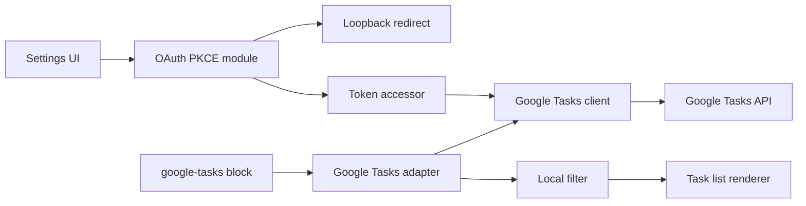

# Requirements

### Overview & Goals

Заменить интеграцию плагина с Todoist на интеграцию с Google Tasks API. Блоки запросов в заметках должны по внешнему виду остаться прежними: та же карточка задачи, те же группировки и сортировка там, где они поддерживаются Google Tasks. Пользователь подключает свой Google-аккаунт через OAuth 2.0 с собственными Client ID и Client Secret; эти данные вводятся в настройках плагина и проверяются при подключении.

### Scope

**In Scope**
- Клиент Google Tasks API (списки задач, задачи: чтение, создание, отметка выполненной).
- OAuth 2.0 подключение: ввод Client ID и Client Secret в настройках, вход через браузер, хранение refresh token, проверка подключения.
- Замена блоков `todoist` на блоки Google Tasks с сохранением визуального вида карточки задачи.
- Упрощённый локальный фильтр в `filter` (вместо серверного фильтра Todoist).
- Настройки, онбординг, модалка создания задачи и команда добавления задачи переведены на Google Tasks.
- Переименование плагина, манифеста и документации под Google Tasks.

**Out of Scope**
- Миграция данных и токенов Todoist (старые настройки сбрасываются, пользователь подключает Google заново).
- Поддержка меток, приоритетов, дедлайнов, длительности и секций (в Google Tasks их нет).
- Подключение с мобильных устройств (см. риски).
- Синхронизация в реальном времени через push-уведомления Google (используется обновление по запросу и автообновление по таймеру).

### User Stories

- Как пользователь, я хочу ввести Client ID и Client Secret в настройках и подключить свой Google-аккаунт, чтобы плагин видел мои задачи.
- Как пользователь, я хочу видеть проверку подключения (успех или понятная ошибка), чтобы понимать, что настройки корректны.
- Как пользователь, я хочу, чтобы блоки `filter: "today | overdue"` показывали мои задачи из Google Tasks с тем же видом, что и раньше.
- Как пользователь, я хочу отмечать задачу выполненной прямо из заметки.
- Как пользователь, я хочу создавать задачу из заметки и выбирать список задач (tasklist), в который она попадёт.
- Как пользователь, я хочу, чтобы опции, которые Google Tasks не поддерживает, не ломали отображение, а сообщали об этом.

### Functional Requirements

- В настройках есть раздел «Google account»: поля Client ID и Client Secret, кнопка «Connect», статус подключения, кнопка «Disconnect», кнопка проверки.
- Подключение: плагин открывает браузер на экран согласия Google (scope `https://www.googleapis.com/auth/tasks`), принимает код на локальный redirect и обменивает его на токены.
- Refresh token и Client Secret хранятся через существующий механизм `tokenStorage` (`secrets` или `file`).
- Проверка подключения вызывает список задач (tasklists) и сообщает об успехе либо об ошибке (неверный Client ID/Secret, отказ пользователя, истёкший токен).
- Блок `filter` поддерживает операторы: `today`, `tomorrow`, `overdue`, `no date`, `list:"Имя списка"`, `|` (или), `&` (и), скобки. Другой синтаксис даёт понятную ошибку разбора (существующий `ParsingError`).
- Опции `show`, `groupBy` и `sorting` поддерживают только значения, для которых есть данные Google Tasks: `due`, `description`, `project` (как список задач), `groupBy: project`, `sorting` по алфавиту, дате и порядку. Для неподдерживаемых значений показывается предупреждение (`QueryWarnings`), запрос не падает.
- Задачи без времени: время срока не показывается, так как Google Tasks хранит только дату.
- Команда «Add task» создаёт задачу с названием, заметкой и сроком в выбранном списке.

### Non-Functional Requirements

- Токены и Client Secret не пишутся в лог (`debug` сообщения маскируют заголовок Authorization и поля секретов).
- Количество запросов ограничено: один запрос списков задач и по одному запросу задач на список на обновление, с пагинацией `pageToken`.
- Интерфейс остаётся доступным (React Aria, i18n для всех строк).

# Technical Design

### Current Implementation

- `plugin/src/api/index.ts` — класс `TodoistApiClient` с методами `getTasks(filter)`, `createTask`, `closeTask`, `getUser`, `sync`; запросы идут через `ObsidianFetcher` (`plugin/src/api/fetcher.ts`) с Bearer-токеном; ошибки — `TodoistApiError`.
- `plugin/src/token.ts` — `TokenValidation` проверяет токен вызовом `getUser()`.
- `plugin/src/services/tokenAccessor.ts` — `VaultTokenAccessor` хранит токен в `secrets` (ID `swt-todoist-api-token`) или в файле `${configDir}/todoist-token`.
- `plugin/src/data/index.ts` — `TodoistAdapter` синхронизирует проекты, секции и метки через `sync`, а блоки получает через `getTasks(filter)` с серверной фильтрацией.
- `plugin/src/data/hydrate.ts` — преобразует API-задачу в `Task` для UI (проект, секция, метки, приоритет, due, duration, deadline).
- `plugin/src/data/transformations/` — `grouping.ts`, `sorting.ts`, `relationships.ts`.
- `plugin/src/query/schema/` — схемы `filter`, `sorting`, `groupBy`, `show`, `view`; `plugin/src/query/injector.tsx` регистрирует блок `todoist`.
- `plugin/src/settings.ts` — Zustand-хранилище; `plugin/src/factories/settings.ts` и `plugin/src/ui/settings/` строят настройки.
- `plugin/src/ui/onboardingModal/TokenInputForm.tsx` — ввод токена; `plugin/src/ui/settings/TokenChecker.tsx` — проверка токена.
- `plugin/src/ui/createTaskModal/` — `ProjectSelector`, `LabelSelector`, `PrioritySelector`, `DeadlineSelector`, `DueDateSelector`.
- `plugin/src/commands/addTask.ts` — команда создания задачи.
- `plugin/src/i18n/` — `translation.ts`, `langs/en.ts`, `langs/nl.ts`.
- `manifest.json` — `id: todoist-sync-plugin`, `name: Todoist Sync`, `isDesktopOnly: false`.

### Key Decisions

- **Google Tasks API через REST-клиент с Bearer-токеном** — тот же подход, что и в текущем `TodoistApiClient`, поэтому `ObsidianFetcher` переиспользуется без изменений.
- **OAuth 2.0 Authorization Code с PKCE и Client Secret, введённым пользователем** — плагин не содержит собственного Client Secret, каждый пользователь использует свой Google Cloud-проект (тип клиента «Desktop app»). Redirect идёт на loopback `http://127.0.0.1:<port>/callback`, потому что Google не принимает пользовательские схемы `obsidian://` для этого типа клиента.
- **Сохранение refresh token через существующий `VaultTokenAccessor`** — выбор `secrets`/`file` сохраняется, меняется только ключ (`swt-google-tasks-token`, файл `google-tasks-token`).
- **Локальный фильтр вместо серверного** — `filter` парсится в предикат, который применяется к загруженным задачам. Загрузка всех списков задач кэшируется в `Repository`.
- **Поля без аналога скрываются с предупреждением** — `labels`, `priority`, `deadline`, `duration`, `section` в `hydrate` выставляются в пустые значения; соответствующие опции в запросах и модалке отключаются.
- **Внутренняя модель `Task` (`plugin/src/data/task.ts`) и компоненты отображения не меняются** — адаптер конвертирует данные Google в ту же форму, чтобы вид заметки не изменился.
- **Блок `google-tasks` и алиас `todoist`** — новый блок регистрируется как `google-tasks`, а `todoist` остаётся псевдонимом с предупреждением. Это сохраняет старые заметки открываемыми (уточнить с пользователем, см. риски).

### Proposed Changes

1. Заменить `TodoistApiClient` на `GoogleTasksApiClient`: методы `listTaskLists()`, `listTasks(listId, opts)` с пагинацией, `insertTask(listId, body)`, `patchTask(listId, taskId, { status: "completed" })`, `refreshAccessToken()`, `revoke()`. При 401 клиент один раз обновляет access token и повторяет запрос.
2. Добавить OAuth-модуль: генерация `code_verifier` и `code_challenge` (S256), сборка URL авторизации, временный HTTP-сервер на loopback для приёма кода (только десктоп), обмен кода на токены.
3. Заменить `TokenValidation.DefaultTester` на проверку через список задач (tasklists) и сопоставлять ошибки с `i18n`.
4. Переписать `TodoistAdapter` в `GoogleTasksAdapter`: `sync()` загружает списки задач; `subscribe(query)` загружает задачи всех списков, применяет локальный фильтр, затем сортировку и группировку; `closeTask` вызывает `patchTask`. Поле `syncToken` и `isPremium` удаляются.
5. Обновить `hydrate`: список задач становится `Project`, секция — `null`, метки — `[]`, приоритет — `P4` (без приоритета), `due` — из поля `due` (только дата), `duration` и `deadline` — `null`, `order` — из `position`, `createdAt` — из `updated` (Google не отдаёт дату создания).
6. Заменить `ProjectSelector` на выбор списка задач; удалить `LabelSelector`, `PrioritySelector`, `DeadlineSelector` из модалки; `DueDateSelector` оставить только для даты.
7. Заменить `TokenInputForm` в онбординге на кнопку «Connect Google account» и поля Client ID / Client Secret.
8. Обновить `settings.ts`: удалить `apiTokenSecretId` (заменить на `googleTokenSecretId`), `renderLabelsIcon`, `taskCreationDefaultLabels`, `taskCreationDefaultProject` (заменить на `taskCreationDefaultTaskList`); добавить `googleClientId`, `googleClientSecretId`.
9. Обновить i18n во всех языках (`en`, `nl`) и интерфейс `translation.ts`.
10. Обновить `manifest.json`, `package.json` (name, description), `README.md`, `docs/docs/*.md` (setup, configuration, query-blocks, overview, команду sync-with-todoist заменить на sync-with-google-tasks).

### File Structure

**Добавляются**
- `plugin/src/api/google/client.ts` — `GoogleTasksApiClient`.
- `plugin/src/api/google/oauth.ts` — PKCE, URL авторизации, обмен кода, обновление токена.
- `plugin/src/api/google/loopback.ts` — временный HTTP-сервер для redirect (только десктоп).
- `plugin/src/api/domain/tasklist.ts`, `plugin/src/api/domain/googleTask.ts` — схемы Zod для ответов Google.
- `plugin/src/query/filter/parser.ts` — парсер локального фильтра.
- `plugin/src/ui/settings/GoogleAccountControl.tsx` — блок подключения.

**Изменяются**
- `plugin/src/api/index.ts` (переименование в `api/google/`), `plugin/src/api/fetcher.ts` (без изменений), `plugin/src/api/validation.ts`.
- `plugin/src/token.ts`, `plugin/src/services/tokenAccessor.ts`, `plugin/src/settings.ts`, `plugin/src/factories/settings.ts`.
- `plugin/src/data/index.ts`, `plugin/src/data/hydrate.ts`, `plugin/src/data/transformations/grouping.ts`, `plugin/src/data/transformations/sorting.ts`.
- `plugin/src/query/injector.tsx`, `plugin/src/query/schema/*.ts`.
- `plugin/src/ui/onboardingModal/TokenInputForm.tsx`, `plugin/src/ui/settings/TokenChecker.tsx`, `plugin/src/ui/settings/index.tsx`, `plugin/src/ui/settings/ProjectDropdownControl.tsx`, `plugin/src/ui/settings/LabelsControl.tsx`.
- `plugin/src/ui/createTaskModal/*`, `plugin/src/commands/addTask.ts`, `plugin/src/commands/index.ts`.
- `plugin/src/i18n/translation.ts`, `plugin/src/i18n/langs/en.ts`, `plugin/src/i18n/langs/nl.ts`.
- `manifest.json`, `plugin/package.json`, `README.md`, `docs/docs/*.md`.

**Удаляются**
- `plugin/src/api/domain/sync.ts`, `plugin/src/api/domain/label.ts`, `plugin/src/api/domain/section.ts`, `plugin/src/api/domain/project.ts` (заменены на tasklist-модели).
- `plugin/src/ui/settings/LabelsControl.tsx`, `plugin/src/ui/createTaskModal/LabelSelector.tsx`, `plugin/src/ui/createTaskModal/PrioritySelector.tsx`, `plugin/src/ui/createTaskModal/DeadlineSelector.tsx`.

### Data Models / Contracts

```ts
// Google Tasks ответы (Zod-схемы в api/domain/googleTask.ts)
type GoogleTaskList = { id: string; title: string; updated: string };
type GoogleTask = {
  id: string;
  title: string;
  notes?: string;
  status: "needsAction" | "completed";
  due?: string;        // RFC 3339, используется только дата
  parent?: string;
  position: string;    // сортировка внутри списка
  updated: string;
  completed?: string;
};

// Локальный фильтр (query/filter/parser.ts)
type FilterNode =
  | { kind: "term"; term: "today" | "tomorrow" | "overdue" | "noDate" }
  | { kind: "list"; name: string }
  | { kind: "and" | "or"; left: FilterNode; right: FilterNode };
function parseFilter(input: string): FilterNode; // throws ParsingError
function matchesFilter(node: FilterNode, task: Task, now: Date): boolean;

// Client API
class GoogleTasksApiClient {
  constructor(accessToken: () => Promise<string>, fetcher: WebFetcher);
  listTaskLists(): Promise<GoogleTaskList[]>;
  listTasks(listId: string): Promise<GoogleTask[]>; // пагинация внутри
  insertTask(listId: string, body: { title: string; notes?: string; due?: string }): Promise<GoogleTask>;
  patchTask(listId: string, taskId: string, body: { status: "completed" }): Promise<GoogleTask>;
}

// Settings (дополнение)
googleClientId: string;
googleClientSecretId: string;   // ID в SecretStorage
googleTokenSecretId: string;   // ID в SecretStorage
taskCreationDefaultTaskList: { listId: string; listName: string } | null;
```

Эндпоинты: `https://tasks.googleapis.com/tasks/v1/users/@me/lists`, `.../lists/{listId}/tasks?showCompleted=false&showHidden=false&maxResults=100&pageToken=...`, `POST .../lists/{listId}/tasks`, `PATCH .../lists/{listId}/tasks/{taskId}`. OAuth: `https://accounts.google.com/o/oauth2/v2/auth`, `https://oauth2.googleapis.com/token`, `https://oauth2.googleapis.com/revoke`.

### Architecture Diagram



### Components

- `GoogleAccountControl` в настройках: Client ID, Client Secret, Connect/Disconnect, статус проверки.
- Блок `google-tasks` в `injector.tsx`: та же карточка задачи (`ui/query/task/`), предупреждения о неподдерживаемых опциях через `QueryWarnings`.
- Модалка создания задачи: поля название, заметка, срок, список задач; отключённые поля без аналога не показываются.

### Risks

- **Мобильные устройства.** Loopback-сервер недоступен в мобильном Obsidian, а `isDesktopOnly` сейчас `false`. Предлагается выставить `isDesktopOnly: true` или отключить подключение на мобильных с понятным сообщением. Требует подтверждения.
- **Client Secret в клиенте.** Для типа «Desktop app» секрет не является тайной, но всё равно хранится через SecretStorage/файл, в логах маскируется.
- **Часовой пояс срока.** Google хранит только дату. Срок нужно отправлять как полночь UTC выбранной даты, иначе дата может сдвинуться. Проверить на нескольких часовых поясах.
- **Дата создания.** Google не возвращает дату создания; сортировка «dateAdded» будет использовать `updated`.
- **Старые блоки `todoist`.** Алиас сохраняет их открываемыми, но фильтры Todoist (например, `#метка`, `p1`) будут выдавать предупреждение.
- **Лимиты API.** Google ограничивает частоту запросов; автообновление по таймеру должно учитывать число списков задач.
- **Документация Google.** Пункты о ограничениях API сверены по собственным знаниям, сайт документации был недоступен; перед реализацией проверить `tasks.list`, поле `due` и scope.

# Testing

### Validation Approach

Все проверки выполняются агентом командами из `plugin/`: `npm run test`, `npm run check`, `npm run lint:check`, `npm run build`. Тесты на Vitest с моком Obsidian (`src/mocks/obsidian.ts`) и моком `WebFetcher` по образцу `src/api/index.test.ts`.

### Key Scenarios

- `GoogleTasksApiClient.listTaskLists` возвращает списки; `listTasks` проходит все страницы по `pageToken`.
- `insertTask` и `patchTask` отправляют корректные тела запросов и заголовки Authorization.
- OAuth: `code_challenge` соответствует `code_verifier` (S256); URL авторизации содержит scope `https://www.googleapis.com/auth/tasks` и redirect loopback.
- Обмен кода на токен: успешный ответ сохраняет refresh token; ошибка `invalid_client` даёт понятное сообщение.
- `TokenValidation` возвращает `success` при успешном списке задач и `error` при 401.
- `parseFilter` и `matchesFilter`: `today | overdue`, `no date & list:"Work"`, `(today | tomorrow) & list:"Home"` дают ожидаемые задачи.
- `hydrate` для задачи Google: `labels` пустые, `priority` = P4, `due` содержит только дату, `section` отсутствует.
- `GoogleTasksAdapter.closeTask` вызывает `patchTask` и удаляет задачу из подписок.
- Блок `google-tasks` и алиас `todoist` рендерят одинаковую карточку; неподдерживаемые опции дают предупреждение.
- Модалка создания задачи не содержит селекторов меток, приоритета и дедлайна.

### Edge Cases

- Refresh token истёк: один повтор с обновлением access token, затем ошибка авторизации с кнопкой переподключения.
- Пользователь закрыл окно согласия без кода: loopback завершается по таймауту, статус сбрасывается.
- Пустой список задач, задачи со статусом `completed` (не показываются по умолчанию).
- Фильтр с неизвестным термином или незакрытой скобкой: `ParsingError`, а не падение плагина.
- Задачи в нескольких списках с одинаковым `title`: сортировка и группировка по списку.
- Срок задачи в разных часовых поясах: дата не сдвигается.
- Client Secret не попадает в debug-лог (проверка маскирования).

### Test Changes

- Обновить: `src/api/index.test.ts` → `src/api/google/client.test.ts`, `src/api/validation.test.ts`, `src/data/index.test.ts`, `src/data/hydrate.test.ts`, `src/data/errors.test.ts`, `src/query/parser.test.ts`, `src/query/replacements.test.ts`, `src/ui/onboardingModal/TokenInputForm.test.tsx`, `src/ui/createTaskModal/taskContent.test.ts`, `src/data/transformations/sorting.test.ts`, `src/data/transformations/grouping.test.ts`.
- Добавить: `src/api/google/oauth.test.ts`, `src/api/google/loopback.test.ts`, `src/query/filter/parser.test.ts`.
- Не трогать: `src/utils/*`, `src/ui/components/*` (кроме тех, где используется `todoist` в текстах).

# Delivery Steps

### ✓ Step 1: Build Google Tasks API client
The plugin talks to Google Tasks through a new REST client that replaces the Todoist client.

- Create `plugin/src/api/google/client.ts` with `GoogleTasksApiClient`: `listTaskLists`, `listTasks` (follows `pageToken`), `insertTask`, `patchTask` (status completed).
- On 401, refresh the access token once and retry the request.
- Add Zod schemas `plugin/src/api/domain/tasklist.ts` and `plugin/src/api/domain/googleTask.ts`.
- Remove `plugin/src/api/domain/sync.ts`, `label.ts`, `section.ts`, `project.ts`, and the Todoist `TodoistApiClient`.
- Write unit tests in `client.test.ts` using a mocked `WebFetcher`, covering pagination, request bodies, and the 401 retry.

### ✓ Step 2: Implement OAuth connection and token validation
Users connect their Google account with their own Client ID and Client Secret, and the plugin verifies the connection.

- Create `plugin/src/api/google/oauth.ts` for PKCE (S256), the authorization URL with scope `https://www.googleapis.com/auth/tasks`, the code-for-token exchange, and token refresh.
- Create `plugin/src/api/google/loopback.ts` for a temporary local HTTP server that receives the redirect code, with a timeout.
- Store the refresh token and Client Secret through `VaultTokenAccessor` in `plugin/src/services/tokenAccessor.ts`, using the new keys `swt-google-tasks-token` and `google-tasks-token`.
- Replace `TokenValidation.DefaultTester` in `plugin/src/token.ts` with a check that lists task lists.
- Write tests in `oauth.test.ts` and `loopback.test.ts` for PKCE, URL construction, and code exchange.

### * Step 3: Replace the data layer and add the local filter
Queries load tasks through the Google adapter, apply a local filter, and keep the existing internal Task model.

- Create `plugin/src/query/filter/parser.ts` with `parseFilter` and `matchesFilter`, supporting `today`, `tomorrow`, `overdue`, `no date`, `list:"Name"`, `|`, `&`, and parentheses. Unsupported syntax throws `ParsingError`.
- Rename `TodoistAdapter` to `GoogleTasksAdapter` in `plugin/src/data/index.ts`. `sync` loads task lists; `subscribe` loads tasks from all lists, applies the filter, then sorts and groups. `closeTask` calls `patchTask`. Drop `syncToken` and `isPremium`.
- Update `plugin/src/data/hydrate.ts`: a task list becomes the `Project`, `section` is null, `labels` is empty, priority is P4, `due` is date-only, `duration` and `deadline` are null, `order` comes from `position`, and `createdAt` comes from `updated`.
- Update `grouping.ts` and `sorting.ts` to drop label, section, priority, and deadline modes that have no Google data, and to keep alphabetical, date, and list-order modes.
- Write tests in `filter/parser.test.ts`, `data/index.test.ts`, and `hydrate.test.ts`.

###   Step 4: Rebuild the settings, onboarding, and task creation UI
The user-facing screens are switched to Google account setup and task-list selection, and unsupported fields are hidden.

- Create `plugin/src/ui/settings/GoogleAccountControl.tsx` with Client ID and Client Secret inputs, Connect and Disconnect buttons, and a connection status.
- Replace `TokenInputForm` in `plugin/src/ui/onboardingModal/` and `TokenChecker` in `plugin/src/ui/settings/` with the new flow.
- Update `plugin/src/settings.ts` and `plugin/src/factories/settings.ts`: add `googleClientId`, `googleClientSecretId`, `googleTokenSecretId`, and `taskCreationDefaultTaskList`; remove `apiTokenSecretId`, `renderLabelsIcon`, `taskCreationDefaultLabels`, and `taskCreationDefaultProject`.
- In `plugin/src/ui/createTaskModal/`, replace `ProjectSelector` with a task-list selector, and remove `LabelSelector`, `PrioritySelector`, and `DeadlineSelector`.
- Update `plugin/src/commands/addTask.ts` to call `insertTask` with title, notes, and due date.
- Update `plugin/src/query/injector.tsx` to register the `google-tasks` block and keep `todoist` as an alias that shows a warning. Update `plugin/src/query/schema/*.ts` so `show`, `groupBy`, and `sorting` accept only supported values.
- Update `plugin/src/ui/settings/LabelsControl.tsx` and `ProjectDropdownControl.tsx` to use task lists.
- Test the modal, settings, and onboarding components with Vitest and React Testing Library.

###   Step 5: Localize, rename, and document the Google Tasks integration
All user-facing text, metadata, and docs refer to Google Tasks, with no Todoist leftovers.

- Update `plugin/src/i18n/translation.ts`, `langs/en.ts`, and `langs/nl.ts`: add Google account strings and remove Todoist labels, priorities, and deadline strings.
- Update `manifest.json` (id, name, description, `isDesktopOnly`), `plugin/package.json`, and `README.md`.
- Update `docs/docs/setup.md`, `configuration.md`, `query-blocks.md`, `overview.md`, and replace `commands/sync-with-todoist.md` with a Google Tasks version.
- Run `npm run test`, `npm run check`, `npm run lint:check`, and `npm run build` from `plugin/`, and fix any failures.