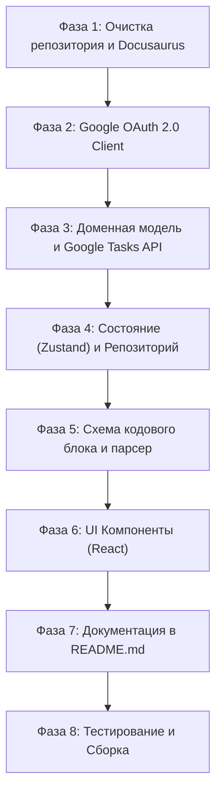

# План разработки: Obsidian Google Tasks Plugin (для AI-агента)

> **Инструкция для AI-агента:** Данный документ представляет собой пошаговый технический план для трансформации форка `obsidian-todoist-plugin` в полнофункциональный плагин **Obsidian Google Tasks Plugin**. Выполняйте задачи строго по фазам. Не переходите к следующей фазе без прохождения тестов (`npm run test`) и проверки линтером (`npm run lint:check`).

---

## 1. Контекст, ограничения и архитектурные решения

1. **Базовая концепция:**
   * Задачи из Google Tasks материализуются в заметках через кодовые блоки (блок `google-tasks`).
   * Заметка хранит только параметры запроса (JSON). Текст заметки **не перезаписывается** при синхронизации.
   * Двусторонняя реакция: изменение статуса задачи или создание задачи отправляет запрос в Google Tasks API и обновляет локальный кэш.

2. **Ключевые ограничения (Уточнения пользователя):**
   * **НЕТ подзадачам:** Иерархия подзадач (`parent`) из Google Tasks **не реализуется**. Все задачи отображаются плоским списком (flat list).
   * **НЕТ Docusaurus:** Полностью удалить Docusaurus и папку `docs/` из монорепозитория. Вся документация (включая пошаговый гайд по настройке Google Cloud) оформляется в **[README.md](file:///c:/Users/dmitr/Documents/Obsidian%20Vault/.obsidian/plugins/obsidian-google-tasks-plugin/README.md)**.
   * **Google OAuth2:** Авторизация через пользовательские **Client ID** и **Client Secret** (Desktop Loopback HTTP Server + ручной ввод при необходимости).

3. **Стек технологий:**
   * TypeScript 5.9+, React 19, Zustand, Zod v4, Vite 7, Biome, Vitest.
   * Архитектура без дефолтных экспортов (`noDefaultExport: error` в Biome).

---

## 2. Фазы разработки



---

### Фаза 1: Очистка репозитория, Docusaurus и манифеста

**Цель:** Удалить лишний воркспейс Docusaurus, исправить опечатки в манифесте и подготовить монорепозиторий.

- [ ] **1.1. Исправить манифесты плагина:**
  - В корневом `manifest.json` и `plugin/manifest.json`:
    - Установить `"id": "obsidian-google-tasks-plugin"` (исправить опечатку `obsidian-google-tasks=plugin`).
    - Установить `"name": "Google Tasks Sync"`.
    - Установить актуальное описание: `"Materialize Google Tasks within Obsidian notes."`.
- [ ] **1.2. Удалить воркспейс Docusaurus:**
  - В корневом `package.json` удалить `"docs"` из секции `"workspaces"`:
    ```json
    "workspaces": [
      "plugin",
      "scripts"
    ]
    ```
  - Удалить директорию `docs/` целиком.
  - В `scripts/src/release.ts` удалить ссылки на сборку документации Docusaurus (если есть).
- [ ] **1.3. Актуализировать CLAUDE.md и package.json:**
  - Обновить имя пакета в корневом `package.json` на `"obsidian-google-tasks-monorepo"`.
  - Убрать упоминание Docusaurus из корневого `CLAUDE.md`.
- [ ] **1.4. Проверка:**
  - Выполнить `npm install` для обновления `package-lock.json`.
  - Убедиться, что `npm run lint:check` проходит без ошибок.

---

### Фаза 2: Модуль аутентификации Google OAuth 2.0

**Цель:** Обеспечить безопасную авторизацию пользователя через собственный Google Cloud проект с получением Access и Refresh токенов.

- [ ] **2.1. Расширить модель настроек (`plugin/src/settings.ts`):**
  - Добавить поля:
    ```typescript
    clientId: string;
    clientSecret: string;
    accessToken: string | null;
    refreshToken: string | null;
    tokenExpiresAt: number | null; // unix timestamp в мс
    userEmail: string | null;
    ```
  - Удалить специфичные для Todoist настройки (например, `apiTokenSecretId`, `taskCreationDefaultLabels` и т.д.).
- [ ] **2.2. Реализовать Loopback OAuth Server (`plugin/src/api/oauth/server.ts`):**
  - Запуск локального `http.createServer` на `127.0.0.1` на случайном свободном порту (или фиксированном диапазоне, например 42813–42820).
  - Генерация ссылки авторизации:
    `https://accounts.google.com/o/oauth2/v2/auth?client_id=...&redirect_uri=http://127.0.0.1:<port>&response_type=code&scope=https://www.googleapis.com/auth/tasks&access_type=offline&prompt=consent`
  - Перехват `GET /?code=...` и отображение пользователю в браузере аккуратной HTML-страницы успеха («Авторизация успешна! Можете закрыть вкладку.»).
  - Закрытие сервера после получения кода (с таймаутом на 2 минуты).
- [ ] **2.3. Реализовать клиент обмена токенов (`plugin/src/api/oauth/client.ts`):**
  - Обмен authorization code на `access_token` и `refresh_token` (`POST https://oauth2.googleapis.com/token`).
  - Метод `refreshAccessToken()`: обновление `access_token`, если до истечения осталось менее 5 минут.
  - Метод `getValidAccessToken()`: автоматическая проверка и прозрачное обновление токена перед каждым запросом.
- [ ] **2.4. Создать UI настроек авторизации в `plugin/src/ui/settings/`:**
  - Поля ввода: `Client ID`, `Client Secret`.
  - Кнопка: **«Войти через Google»** (Login with Google) со статусом (Не авторизован / Авторизован как `email`).
  - Кнопка: **«Выйти»** (очистка токенов).

---

### Фаза 3: Доменные модели и Google Tasks API Client

**Цель:** Заменить клиент Todoist на API клиент Google Tasks v1 с поддержкой списков и задач.

- [ ] **3.1. Создать доменные типы (`plugin/src/api/domain/`):**
  - Удалить: `project.ts`, `section.ts`, `label.ts`.
  - Создать `taskList.ts`:
    ```typescript
    export type TaskList = {
      id: string;
      title: string;
      updated: string;
    };
    ```
  - Создать `googleTask.ts`:
    ```typescript
    export type GoogleTask = {
      id: string;
      title: string;
      notes?: string;
      status: "needsAction" | "completed";
      due?: string;        // RFC 3339 формат
      completed?: string;  // RFC 3339 формат
      updated: string;
      position: string;    // порядок задач
      taskListId: string;  // ID списка, к которому принадлежит задача
    };
    ```
- [ ] **3.2. Реализовать `GoogleTasksApiClient` (`plugin/src/api/client.ts`):**
  - Использовать `ObsidianFetcher` (или `requestUrl` из Obsidian API) с заголовком `Authorization: Bearer <accessToken>`.
  - Методы:
    - `getTaskLists(): Promise<TaskList[]>` (`GET /tasks/v1/users/@me/lists`)
    - `getTasks(taskListId: string, options?: { showCompleted?: boolean; updatedMin?: string }): Promise<GoogleTask[]>` (`GET /tasks/v1/lists/{taskListId}/tasks`)
    - `createTask(taskListId: string, task: Partial<GoogleTask>): Promise<GoogleTask>` (`POST /tasks/v1/lists/{taskListId}/tasks`)
    - `updateTask(taskListId: string, taskId: string, patch: Partial<GoogleTask>): Promise<GoogleTask>` (`PATCH /tasks/v1/lists/{taskListId}/tasks/{taskId}`)
    - `completeTask(taskListId: string, taskId: string): Promise<GoogleTask>`
    - `uncompleteTask(taskListId: string, taskId: string): Promise<GoogleTask>`
    - `deleteTask(taskListId: string, taskId: string): Promise<void>` (`DELETE /tasks/v1/lists/{taskListId}/tasks/{taskId}`)
- [ ] **3.3. Написать модульные тесты:**
  - Покрыть мок-тестами парсинг ответов Google Tasks API и обработку ошибок (401, 403 квоты, 404).

---

### Фаза 4: Состояние и синхронизация (Zustand + Repository)

**Цель:** Хранить задачи в локальном кэше памяти и производить быструю выборку без постоянных сетевых запросов при переключении заметок.

- [ ] **4.1. Переписать `DataIndex` / `Repository` (`plugin/src/data/`):**
  - Заменить структуры проектов Todoist на `taskLists: Map<string, TaskList>`.
  - Хранить задачи в `tasks: Map<string, GoogleTask>`.
  - Удалить логику обработки иерархии подзадач и приоритетов.
- [ ] **4.2. Фоновый синхронизатор (`plugin/src/services/synchronizer.ts`):**
  - Опрос Google Tasks API с интервалом (настраивается в settings, например каждые 60 сек).
  - Первоначальная гидратация при старте Obsidian: загрузка всех списков и активных задач.
  - Оптимистичные обновления: при клике на чекбокс задача в локальном стейте мгновенно меняет статус, а в фоне отправляется PATCH запрос. При ошибке — откат статуса и показ уведомления (Notice).

---

### Фаза 5: Схема кодового блока и клиентская фильтрация

**Цель:** Создать валидатор Zod и парсер параметров кодового блока `google-tasks`.

- [ ] **5.1. Разработать Zod-схему кодового блока (`plugin/src/query/schema/`):**
  ```typescript
  import { z } from "zod/v4";

  export const taskQuerySchema = z.object({
    name: z.string().optional(),
    list: z.union([z.string(), z.array(z.string())]).optional().default("all"),
    filter: z.object({
      status: z.enum(["needsAction", "completed", "all"]).optional().default("needsAction"),
      due: z.enum(["today", "overdue", "today-and-overdue", "upcoming", "no-date", "all"]).optional().default("all"),
      search: z.string().optional(),
    }).optional().default({}),
    sorting: z.enum(["date", "my-order", "title"]).optional().default("date"),
    sortOrder: z.enum(["asc", "desc"]).optional().default("asc"),
    groupBy: z.enum(["none", "list", "date"]).optional().default("none"),
    show: z.array(z.enum(["notes", "due", "list"])).optional().default(["notes", "due"]),
    limit: z.number().positive().optional(),
    autorefresh: z.number().nonnegative().optional(),
  });

  export type TaskQuery = z.infer<typeof taskQuerySchema>;
  ```
- [ ] **5.2. Реализовать движок клиентской фильтрации (`plugin/src/query/filter.ts`):**
  - Фильтр по спискам: сопоставление по имени или `taskListId`.
  - Фильтр по датам `due`:
    - Использовать текущую локальную дату пользователя.
    - Корректная обработка UTC-дат из Google Tasks (например, `2026-10-30T00:00:00.000Z`).
  - Фильтр по поисковой строке: регистронезависимое вхождение в `title` или `notes`.
  - Сортировка: по дате `due`, по алфавиту, или по оригинальному свойству `position`.
- [ ] **5.3. Регистрация процессора в `plugin/src/index.ts`:**
  - Зарегистрировать кодовый блок `google-tasks` (и алиас `gtasks`) через `this.registerMarkdownCodeBlockProcessor`.

---

### Фаза 6: UI Компоненты (React)

**Цель:** Отрендерить список задач в кодовом блоке в стилистике нативного интерфейса Obsidian.

- [ ] **6.1. Компонент `TaskList`:**
  - Отображение заголовка запроса (`name`).
  - Группировка задач (по спискам или по временным отрезкам: «Просроченные», «Сегодня», «Предстоящие»), если включен `groupBy`.
  - Состояние загрузки (skeleton / spinner) и состояние пустого списка («Нет задач»).
- [ ] **6.2. Компонент `TaskItem`:**
  - Чекбокс: кликабельный, переключает статус `needsAction` $\leftrightarrow$ `completed`.
  - Заголовок задачи: поддержка кликабельных markdown-ссылок (URL).
  - Поле `notes`: отображение описания задачи со свернутым/развернутым состоянием.
  - Бейдж даты исполнения (`due`) с цветовой индикацией (красный для просроченных, акцентный для сегодняшних).
  - Бейдж названия списка (если задача отображается в сводном виде по нескольким спискам).
- [ ] **6.3. Компонент быстрого добавления задачи (`TaskCreateForm`):**
  - Кнопка «+ Добавить задачу» внизу блока.
  - Поле ввода названия и выбор даты.
  - Создание задачи напрямую в список, указанный в параметре `list`.

---

### Фаза 7: Документация в README.md

**Цель:** Создать самодостаточную, подробную документацию в `README.md` без использования Docusaurus.

- [ ] **7.1. Структура [README.md](file:///c:/Users/dmitr/Documents/Obsidian%20Vault/.obsidian/plugins/obsidian-google-tasks-plugin/README.md):**
  - **Описание плагина:** для чего он нужен и ключевые преимущества (встроенные задачи через кодовый блок без перезаписи заметок).
  - **Пошаговая инструкция по настройке Google Cloud Console (OAuth 2.0):**
    1. Создание проекта на https://console.cloud.google.com/.
    2. Включение **Google Tasks API**.
    3. Настройка OAuth Consent Screen (выбор типа *External*, добавление своего email в *Test Users*).
    4. Создание **OAuth 2.0 Client ID** (тип *Desktop App*).
    5. Копирование Client ID и Client Secret в настройки плагина в Obsidian.
  - **Справочник кодового блока `google-tasks`:**
    - Примеры базовых запросов (на сегодня, по конкретному списку, поиск).
    - Таблица всех доступных параметров (`list`, `filter`, `sorting`, `groupBy`, `show`, `limit`).
  - **Частые вопросы и Troubleshooting:**
    - Ошибка `403 rateLimitExceeded` / квоты.
    - Истечение тестового токена через 7 дней (объяснение режима Testing vs Publishing в Google Console).

---

### Фаза 8: Тестирование, аудит и сборка

**Цель:** Убедиться в работоспособности плагина и подготовить релизные файлы.

- [ ] **8.1. Запустить юнит-тесты:**
  - `npm run test` в воркспейсе `plugin/`.
  - Убедиться, что тесты Todoist удалены/заменены на тесты Google Tasks.
- [ ] **8.2. Проверить код линтером:**
  - `npm run lint:check` (Biome). Устранить все замечания форматирования и типов.
- [ ] **8.3. Сборка артефактов:**
  - `npm run build` в воркспейсе `plugin/`.
  - Убедиться, что на выходе генерируются валидные `main.js`, `manifest.json` и `styles.css`.
- [ ] **8.4. Тестирование в Obsidian:**
  - Перезагрузить плагин в Obsidian.
  - Пройти авторизацию и протестировать отображение задач в тестовой заметке.

