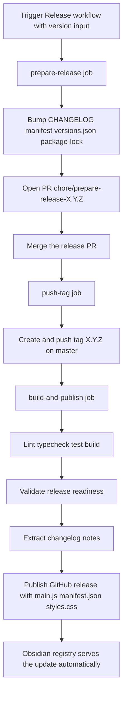

# Releasing

This document describes the fully automated release pipeline and the (one-time,
manual) Obsidian community submission.

## Overview



## How to cut a release

### Option 1: local convenience wrapper

```bash
npm run release -- 1.2.3
```

This triggers the `Release` workflow via the `gh` CLI and prints how to watch
the run. No other local steps are needed - the entire pipeline runs on GitHub
Actions.

### Option 2: GitHub UI / CLI directly

Dispatch the **Release** workflow (`release-orchestration.yml`) on `master`
with the version input:

```bash
gh workflow run release-orchestration.yml -f version=1.2.3 --ref master
```

## What the pipeline does

1. **prepare-release** (`release-orchestration.yml`)
   - Runs `npm run prepare-release -- <version>` ([scripts/src/prepare-release.ts](scripts/src/prepare-release.ts)):
     - Renames the `## Unreleased` section in [CHANGELOG.md](CHANGELOG.md) to `## vX.Y.Z (date)`.
     - Bumps `version` in [manifest.json](manifest.json) and [plugin/package.json](plugin/package.json).
     - Syncs `minAppVersion` in the manifest from the `obsidian` dependency version.
     - Adds the version to [versions.json](versions.json) and refreshes `package-lock.json`.
   - Pushes `chore/prepare-release-<version>`, opens a PR and merges it
     (auto-merge when enabled in the repo settings, otherwise it merges
     directly).
2. **push-tag** - creates an annotated tag `<version>` on merged `master` and
   pushes it. The tag name must equal the manifest version (validated later).
3. **build-and-publish** ([release-build.yml](.github/workflows/release-build.yml), reusable)
   - Checks out the tag, then runs lint, typecheck, tests and the production build.
   - Runs `npm run validate-release -- <version>` ([scripts/src/validate-release.ts](scripts/src/validate-release.ts)):
     - Tag is strict semver.
     - `manifest.json` version equals the tag.
     - `versions.json` contains an entry for the tag.
     - `plugin/dist/{main.js,manifest.json,styles.css}` exist.
   - Extracts the changelog section for the version
     ([scripts/src/extract-changelog.ts](scripts/src/extract-changelog.ts)) into the release notes.
   - Publishes the GitHub release (**non-draft**) with `main.js`, `manifest.json`
     and `styles.css` as assets.

### Fallback: manual tag

Pushing a tag matching `*.*.*` manually triggers [release.yml](.github/workflows/release.yml),
which calls the same reusable build workflow. Use this only for hotfixes - the
version files must already be correct on the tagged commit.

## Repository settings required

- **Actions** enabled with workflow permissions allowing **Read and write** for
  contents and pull requests (the workflows also declare the needed
  `permissions` blocks).
- **Allow GitHub Actions to create and approve pull requests** (Settings →
  Actions → General → Workflow permissions): the `prepare-release` job opens
  the release PR with `GITHUB_TOKEN` and fails without it. Equivalent API
  call: `gh api -X PUT repos/<owner>/<repo>/actions/permissions/workflow -f default_workflow_permissions=write -F can_approve_pull_request_reviews=true`.
- **Allow auto-merge** (optional but recommended): Settings → General → Pull
  Requests → *Allow auto-merge*. When disabled, the pipeline merges the release
  PR directly instead.
- The release PR does not run the `premerge` checks: the pipeline pushes the
  release branch with `GITHUB_TOKEN`, and pushes made with `GITHUB_TOKEN` do
  not trigger other workflows. The `build-and-publish` job is the safety net -
  it re-runs lint, typecheck, tests and the build before publishing.

## Obsidian community deployment

### One-time submission (deferred - do this after the planned fixes)

The initial listing in the official community directory is manual and reviewed
by the Obsidian team. When ready, submit a PR to
[obsidianmd/obsidian-releases](https://github.com/obsidianmd/obsidian-releases)
adding an entry to `community-plugins.json`:

```json
{
  "id": "obsidian-google-tasks-plugin",
  "name": "Google Tasks Sync",
  "author": "Dmitrij Rebrov",
  "description": "Materialize Google Tasks within Obsidian notes.",
  "repo": "drebroff/obsidian-google-tasks-plugin"
}
```

Submission checklist:

- [ ] Latest GitHub release is **published** (not draft) with tag == `manifest.json` version.
- [ ] Release assets: `main.js`, `manifest.json`, `styles.css`.
- [ ] [manifest.json](manifest.json) contains `id`, `name`, `version`, `minAppVersion`, `description`, `author`, `authorUrl`.
- [ ] [versions.json](versions.json) maps every released version to its minimum Obsidian version.
- [ ] [README.md](README.md) documents installation and the Google Cloud OAuth setup.
- [ ] `LICENSE` present; no obfuscated or minified-only code.
- [ ] Plugin follows the [Obsidian developer policies](https://docs.obsidian.md/Reference/Manifest).

### Ongoing updates (automatic)

Once the plugin is listed, **no extra deployment steps are needed**: the
Obsidian registry reads `manifest.json` and `versions.json` from the repository
HEAD and serves the binaries from the GitHub release whose tag matches the
manifest version. Every release published by this pipeline is picked up by the
registry automatically.
